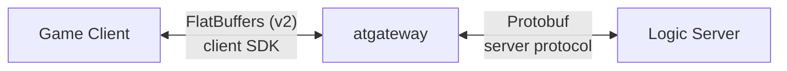
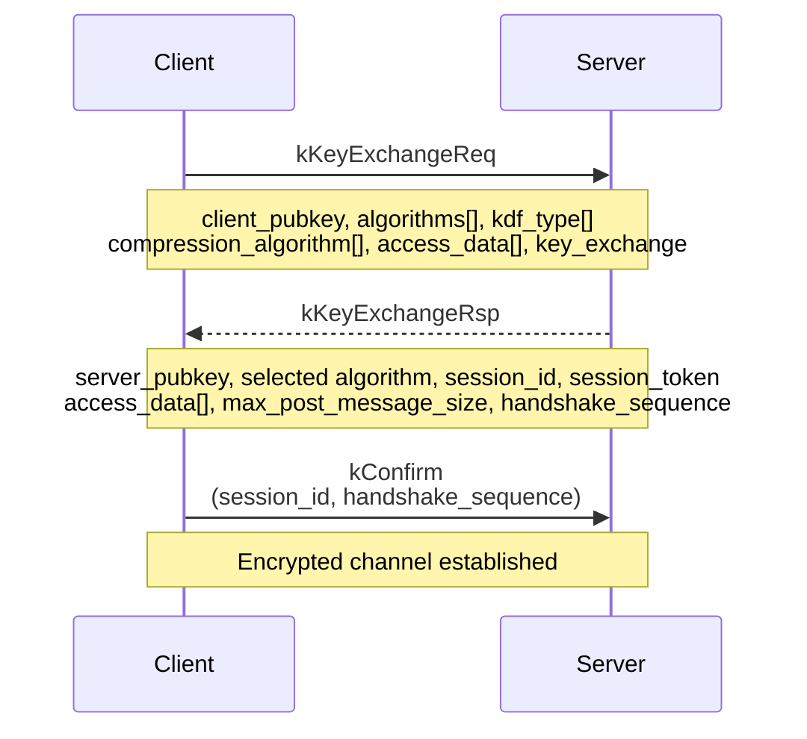
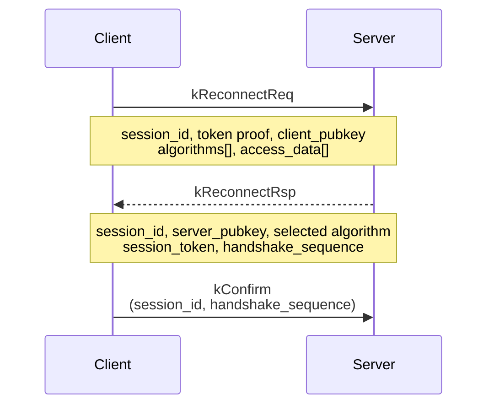

# atgateway Protocol v2

## Overview

The atgateway v2 protocol provides secure, encrypted communication between game
clients and gateway servers. It uses a **2-message ECDH key exchange**, inspired
by libatbus's `node_register_req`/`node_register_rsp` flow.

All wire messages use **FlatBuffers** serialization (`libatgw_protocol_sdk.fbs`).
Each frame starts with a 32-bit MurmurHash3 of the payload (seed 0, native byte
order), followed by a 32-bit little-endian payload length and the payload.
Before handshake completion, the payload limit is 8192 bytes. Invalid lengths
are rejected as soon as the complete 8-byte header arrives.

## Architecture

The protocol is split into two layers:

- **Client SDK** (`libatgw_protocol_sdk` / `libatgw_protocol_api`) — handles
  client↔gateway wire protocol: handshake, encryption, compression, ping/pong,
  reconnection, kickoff.
- **Server protocol** (`libatgw_server_protocol.proto`) — Protobuf messages
  between the gateway process and backend logic servers (post, session
  add/remove, kickoff, router set).



## Handshake Flow

### New Session (kKeyExchangeReq / kKeyExchangeRsp)



After both sides have each other's ECDH public key, they derive:

```text
shared_secret = ECDH(my_private, peer_public)
key_material  = HKDF-SHA256(shared_secret, nil, nil, key_size + iv_size)
KEY           = key_material[0 .. key_size-1]
legacy_IV     = key_material[key_size .. key_size+iv_size-1]
```

The key derivation and its output length remain unchanged. Each full ECDH
exchange, including key refresh and reconnect, initializes a new cipher with an
independent cryptographically random IV for each sending direction. When calling
`setup_crypto_with_key` directly, an explicit IV is copied unchanged; an empty
IV requests random initialization using `get_iv_size()`. Ciphers with no IV skip
this step.

The first encrypted message after initialization or an explicit IV reset carries
that IV. For the server, this is normally the encrypted session token in the
handshake response. Subsequent messages omit the IV and continue the cipher's
state. If an encrypted post cannot enter the send queue, the next post carries
the current IV to resynchronize the receiver. The SDK does not interpret
direction bits, nonce fields, counters, or byte order. IV generation, IV setup,
and encryption failures return `kCryptoOperation`.

For direct `encrypt_data` calls, start each ordinary call with an empty `iv`
span. A non-empty input requests an explicit reset; the returned span contains
the IV to transmit with that packet, if any.

The cipher component advances its own IV. Its ChaCha20 block counter uses
unsigned 64-bit arithmetic and wraps modulo 2^64; crossing the numeric boundary
does not by itself reject a packet. Senders and receivers advance identically.
Reusing a complete key/nonce/counter combination must still be avoided.

Independent random IVs reduce the chance of both directions starting from the
same IV; uniqueness is probabilistic. Retain periodic full key exchanges to
limit use of a single key. Callers supplying explicit IVs are responsible for
their uniqueness. Peers must adopt a received IV and advance their receive
cipher after every successful decryption, including the handshake token.

The client sends `kConfirm` to tell the server it has switched to the new
receive cipher. The server then switches its receive cipher.

### Reconnect (kReconnectReq / kReconnectRsp)



Reconnect performs a full ECDH key exchange inline (same fields as new session)
but reuses the existing `session_id`. The session token is rotated on each
successful reconnect. A fresh SDK can initiate reconnect with the previous ID
and token. The token is used to sign the request; it is not sent in plaintext.
The server's `reconnect_fn` must call `check_reconnect(previous_sdk)` before
moving the previous session to the new transport. That check authenticates the
request using the previous session's credentials. Returning success without a
successful check does not authorize reconnect.

If `reconnect_session()` returns a negative value, the SDK retains or restores
its previous session ID, token, and router hash. The failure can still close the
connection; restoring these fields does not restore its crypto context or reopen
it. A zero return reports request submission. The handshake outcome, including
later asynchronous failures, is delivered through the handshake callbacks.

When no access token is configured, reconnect uses the previous session token
as the HMAC key in the existing `access_data` field. Unsigned reconnect requests
are rejected. Both peers need this behavior for reconnect without access tokens.

### Key Refresh (handshake_update)

Key refresh re-runs the 2-message ECDH exchange on an established session to
rotate encryption keys and reset each direction's IV. The new server IV is
published with the encrypted session token; the new client IV is published with
its first encrypted post. The session ID is preserved. During the transition the
server retains the old receive cipher until the client confirms, then switches
to the pending `handshaking_receive_cipher`. On the initial handshake, encrypted
posts are rejected until that confirmation arrives. Repeated or reserved
confirmation sequences cannot clear the active receive cipher.
An authenticated refresh on the current transport uses its current session
token and does not invoke the session-migration callback.

### Compatibility with the v2 SDK at `d5ec9c3c0133`

Initial handshakes and bidirectional posts interoperate with the old C++ client;
this was exercised with AES-256-GCM and AES-256-CBC, with and without access
tokens. The old `handshake_update()` omits the previous session token and fails
authentication against the updated server, including when invoked by its
periodic refresh timer. Calling the old `reconnect_session(id, token)` on the
current connection works with configured access tokens; without them, the old
client supplies no token proof and is rejected. Clients using automatic refresh
or reconnect without access tokens must update their SDK.

The Go client must also preserve the IV received with the handshake token and
adopt explicit IV resets before advancing its receive state. Older Go clients
that continue advancing only the HKDF-derived IV cannot receive posts with an
omitted IV after a random initialization or reset. Update
`conn/atgateway/gateway_session.go` for this behavior; the wire schema is unchanged.

## Key Exchange Algorithms

| Enum value   | DH parameter     | Notes                  |
| ------------ | ---------------- | ---------------------- |
| `kX25519`    | `ecdh:X25519`    | Default, TLS 1.3 style |
| `kSecp256r1` | `ecdh:secp256r1` | NIST P-256             |
| `kSecp384r1` | `ecdh:secp384r1` | NIST P-384             |
| `kSecp521r1` | `ecdh:secp521r1` | NIST P-521             |

## Crypto Algorithms

| Enum value               | Cipher name             | Type        |
| ------------------------ | ----------------------- | ----------- |
| `kXxtea`                 | xxtea                   | Block       |
| `kAes128Cbc`             | aes-128-cbc             | Block/PKCS7 |
| `kAes192Cbc`             | aes-192-cbc             | Block/PKCS7 |
| `kAes256Cbc`             | aes-256-cbc             | Block/PKCS7 |
| `kAes128Gcm`             | aes-128-gcm             | AEAD        |
| `kAes192Gcm`             | aes-192-gcm             | AEAD        |
| `kAes256Gcm`             | aes-256-gcm             | AEAD        |
| `kChacha20`              | chacha20                | Stream      |
| `kChacha20Poly1305Ietf`  | chacha20-poly1305-ietf  | AEAD        |
| `kXchacha20Poly1305Ietf` | xchacha20-poly1305-ietf | AEAD        |

Algorithm negotiation: the client sends all supported algorithms (ordered by
preference); the server selects the first mutually supported one.
If there is no common cipher, the handshake fails. Plaintext requires both
peers to configure empty lists or lists containing only `kNone`. A peer
negotiating encryption must supply its ECDH public key.

### IV continuation and backend interoperability

Omitting an IV continues the state managed by `atframe_utils::crypto::cipher`.
It does not rely on different crypto libraries retaining identical internal
contexts. The adapter supplies its current IV to each backend operation, then
advances it only after success. Each peer must preserve message boundaries:

| Algorithm | State after a successful message |
| --- | --- |
| AES-GCM, ChaCha20-Poly1305-IETF, XChaCha20-Poly1305-IETF | Increment the IV as a big-endian integer by one |
| AES-CBC | Use the final ciphertext block as the next IV |
| ChaCha20 | Advance the little-endian 64-bit counter by the number of 64-byte blocks consumed, rounding up |
| XXTEA | No IV |

AEAD wire data is ciphertext followed by the authentication tag. AES-CBC and
XXTEA messages use the gateway's block-alignment padding; an already aligned
plaintext does not acquire an extra block. Backend defaults must not change
these conventions.

The adapter was checked with OpenSSL 3.5.7, mbedTLS 2.28.10/3.6.3, and libsodium
1.0.22 on Windows x64. Six consecutive messages of 8, 15, 16, 17, 64, and 97 bytes
produced matching ciphertext and next-IV records. AES uses the selected OpenSSL
or mbedTLS backend; raw ChaCha20 and XChaCha20 use libsodium. The IETF
ChaCha20-Poly1305 path was compared between OpenSSL and libsodium. The Go client
matched the nine algorithms it implements; it does not implement raw ChaCha20.
These are cipher-adapter checks, not a complete handshake matrix for every
backend/version. LibreSSL, BoringSSL, and big-endian platforms were not exercised.

mbedTLS 2.x's detached-tag decrypt API requires the ciphertext length to exclude
the tag. The Go XXTEA implementation must read key words in big-endian order
and apply the gateway's alignment padding. XXTEA data words in the C++ component
use native byte order, so the verified Go/C++ interoperability is limited to
little-endian platforms.

## Compression Algorithms

| Enum value | Name   |
| ---------- | ------ |
| `kZstd`    | zstd   |
| `kLz4`     | lz4    |
| `kSnappy`  | snappy |
| `kZlib`    | zlib   |

Messages smaller than `compression_threshold_size` (default 1024 bytes) bypass
compression. Compression is applied **before** encryption.

### Compression Levels

| Level        | Description                            |
| ------------ | -------------------------------------- |
| `kDefault`   | Algorithm's recommended default        |
| `kStorage`   | Lowest CPU, may store uncompressed     |
| `kFast`      | Extreme speed                          |
| `kLowCpu`    | Low overhead, slight ratio tradeoff    |
| `kBalanced`  | Recommended general-purpose            |
| `kHighRatio` | High ratio, higher CPU                 |
| `kMaxRatio`  | Extreme compression, offline/cold data |

## Authentication

Each handshake message carries one or more `access_data` entries. Each entry
contains:

| Field       | Description                                |
| ----------- | ------------------------------------------ |
| `algorithm` | Always `kHmacSha256`                       |
| `timestamp` | Unix epoch seconds (server rejects ±300 s) |
| `nonce1`    | Random 64-bit value                        |
| `nonce2`    | Random 64-bit value                        |
| `signature` | HMAC-SHA256 over the plaintext below       |

**Plaintext** (used for HMAC input):

```text
{timestamp}:{nonce1}-{nonce2}:{session_id}:{key_exchange_int}:{sha256_hex(public_key)}
```

The signature helper also supports input without a public key:

```text
{timestamp}:{nonce1}-{nonce2}:{session_id}
```

Complete SDK handshakes still require an ECDH public key, including when both
peers select plaintext transport.

Both peers verify handshake signatures against **all configured access tokens**
(any match is accepted). Multiple tokens enable zero-downtime key rotation.
Reconnect and key refresh also bind the proof to the previous session token.
Their HMAC input appends `:{sha256_hex(previous_session_token)}` to the
plaintext above.

## Message Types

The wire envelope is `client_message` (FlatBuffers), containing a head and a
body union:

| Type         | Description                                          |
| ------------ | ---------------------------------------------------- |
| `kHandshake` | Key exchange / reconnect request or response         |
| `kPost`      | Application data (encrypted + optionally compressed) |
| `kPing`      | Ping request (carries a timepoint)                   |
| `kPong`      | Pong response (echoes the ping timepoint)            |
| `kKickoff`   | Server kicks client (reason + sub_reason + message)  |
| `kConfirm`   | Client confirms cipher switch after handshake        |

### Post Message Structure

```text
cs_body_post {
  crypto {
    algorithm   // cipher used for this packet
    iv          // IV/nonce for this encryption (if any)
    aad         // AAD for AEAD ciphers
  }
  compression {
    type           // compression algorithm used (kNone if not compressed)
    original_size  // compressed byte count before encryption/padding
  }
  length   // plaintext byte count before compression and encryption
  data     // encrypted (and possibly compressed) payload
}
```

The receiver bounds `length` before decompression and rejects a decoded buffer
shorter than that length. The message limit applies to plaintext; the encoded
frame allowance includes cipher padding, tags, and protocol metadata.
Compression metadata must match the negotiated algorithm.
Unencrypted, uncompressed posts may contain an empty `data` vector with
`length = 0`; the message callback receives an empty span. A missing `data`
vector is invalid. Empty outgoing posts skip compression even when it was
negotiated. Compressed posts require nonzero declared output and compressed
sizes to keep decompression bounded.

After decryption, the receiver trims cipher padding to the compressed byte
count before decompression, then trims the decoded output to `length`.
Both trims check buffer bounds first; the protocol does not inspect padding
bytes or assume a cipher-specific padding format. Trailing bytes are trimmed
to the declared lengths regardless of the selected cipher.

Malformed messages and decode failures invoke `on_error_fn` once, then close
with a `close_reason_t` value. Transport write failures discard queued output,
report the transport error once, and close with `kReset`; an already requested
close preserves its original reason. The gateway's existing error log includes
the session ID and protocol instance. These paths do not log payloads or tokens.

The transport retries transient write errors such as `EAGAIN` and `EINTR`,
retaining its partial-write offset. While pending, `write_fn` returns zero
with `is_done = false`; the SDK keeps the buffer valid. `write_done(status)`
reports completion of the entire buffer, with zero for success or a negative
terminal error. The gateway's `uv_write` transport handles retryable I/O
conditions inside libuv.

## Configuration (Protobuf)

Server-side configuration in `libatgw_server_config.proto`:

```protobuf
message atgateway_client_crypto_cfg {
  repeated bytes access_tokens = 1;                          // HMAC keys
  google.protobuf.Duration update_interval = 2;              // key refresh interval (default 300s)
  atgateway_key_exchange_type key_exchange = 3;              // ECDH curve (default x25519)
  repeated atgateway_crypto_algorithm algorithms = 4;        // supported ciphers
  repeated atgateway_compression_algorithm compression_algorithms = 5;
  repeated atgateway_kdf_algorithm kdf_algorithms = 6;
  uint64 max_post_message_size = 7;                          // default 2MB
}

message atgateway_client_cfg {
  google.protobuf.Duration reconnect_timeout = 1;  // default 180s
  google.protobuf.Duration first_idle_timeout = 2;  // default 10s
  uint64 recv_buffer_size = 3;                       // default 2MB
  uint64 send_buffer_size = 4;                       // default 4MB
  atgateway_router_cfg default_router = 5;
  atgateway_client_limit_cfg limit = 11;
  atgateway_client_crypto_cfg crypto = 12;
}

message atgateway_cfg {
  atgateway_listen_cfg listen = 1;
  atgateway_client_cfg client = 2;
  bool echo_server = 3;   // echo-back mode for testing
}
```

## Server Protocol (gateway ↔ logic server)

Defined in `libatgw_server_protocol.proto`, using Protobuf:

```protobuf
message server_message {
  server_message_head head = 1;   // session_id + error_code
  server_message_body body = 2;   // oneof: post, add_session, remove_session,
                                  //        kickoff_session, set_router_req/rsp
}
```

## FlatBuffers Schema

See `atgateway/protocol/v2/libatgw_protocol_sdk.fbs` for the full client wire
schema. Key types:

- `cs_body_handshake` — handshake request/response body
- `cs_body_post` — encrypted application data
- `cs_body_confirm` — cipher switch confirmation
- `cs_body_ping` — ping with timepoint
- `cs_body_kickoff` — kickoff with reason/sub_reason/message
- `client_message` — top-level envelope (union body)

File identifier: `"ATGW"`

## API Quick Reference

### Create shared configuration

```cpp
using libatgw_protocol_sdk = atframework::gateway::v2::libatgw_protocol_sdk;

libatgw_protocol_sdk::crypto_conf_t conf;
conf.key_exchange_algorithm = key_exchange_t::kX25519;
conf.supported_algorithms.push_back(crypto_algorithm_t::kAes256Gcm);
conf.access_tokens.push_back({...});
conf.max_post_message_size = 2 * 1024 * 1024;
conf.update_interval = 300;
conf.client_mode = false;  // true for client side

auto shared_ctx = libatgw_protocol_sdk::create_shared_context(conf);
```

### Create protocol instance

```cpp
auto sdk = std::make_shared<libatgw_protocol_sdk>(shared_ctx);

// Set callbacks
libatgw_protocol_api::proto_callbacks_t cbs;
cbs.write_fn = ...;        // required: send data to peer
cbs.message_fn = ...;      // required: receive application message
cbs.new_session_fn = ...;  // required: assign session ID
cbs.reconnect_fn = ...;    // optional: accept/reject reconnect
cbs.close_fn = ...;        // required: handle close
cbs.on_handshake_done_fn = ...;    // optional: handshake complete
cbs.on_handshake_update_fn = ...;  // optional: key refresh complete
cbs.on_error_fn = ...;            // optional: error reporting
sdk->set_callbacks(&cbs);
```

### Client-side: start session

```cpp
int ret = sdk->start_session();  // sends kKeyExchangeReq
```

### Client-side: reconnect

```cpp
int ret = sdk->reconnect_session(old_session_id, old_session_token);
```

### Send / receive messages

```cpp
// Send application data
sdk->send_post(data_span);

// Receive: handled via message_fn callback

// Ping/pong
sdk->send_ping();

// Kickoff
sdk->send_kickoff(reason, sub_reason, message);

// Key refresh
sdk->handshake_update();
```

### Per-session crypto (testing / bypass DH)

```cpp
libatgw_protocol_sdk::crypto_session_t session;
session.setup_crypto_with_key(
    crypto_algorithm_t::kAes256Gcm,
    gsl::span<const unsigned char>{key, 32},
    gsl::span<const unsigned char>{iv, 12},
    false  // need_confirm
);

// Encrypt / decrypt
session.encrypt_data(in, out, compression_heap, crypto_heap, iv, aad);
session.decrypt_data(in, out, heap, iv, aad);
```

### Algorithm name ↔ enum helpers

```cpp
auto ke = libatgw_protocol_sdk::key_exchange_algorithm_from_name("ecdh:x25519");
auto ca = libatgw_protocol_sdk::crypto_algorithm_from_name("aes-256-gcm");
auto co = libatgw_protocol_sdk::compression_algorithm_from_name("zstd");

const auto& ke_names = libatgw_protocol_sdk::get_all_key_exchange_algorithm_names();
const auto& ca_names = libatgw_protocol_sdk::get_all_crypto_algorithm_names();
const auto& co_names = libatgw_protocol_sdk::get_all_compression_algorithm_names();
```

## Error Codes

Defined in `libatgw_protocol_api.h` (`atframework::gateway::error_code_t`):

| Code  | Name                           | Description                           |
| ----- | ------------------------------ | ------------------------------------- |
| 0     | `kSuccess`                     | Success                               |
| -1001 | `kFirstIdel`                   | First idle timeout                    |
| -1002 | `kHandshake`                   | Handshake error                       |
| -1003 | `kBusy`                        | Busy                                  |
| -1004 | `kSessionExpired`              | Session expired                       |
| -1005 | `kRefuseReconnect`             | Reconnect refused                     |
| -1013 | `kMessageTooLarge`             | Message exceeds max_post_message_size |
| -1019 | `kCryptoAlgorithmNotSupported` | Cipher not available                  |
| -1021 | `kBadData`                     | Malformed data                        |
| -1102 | `kCryptoVerify`                | Crypto verification failed            |
| -1103 | `kCryptoOperation`             | Crypto operation failed               |

## Close Reasons

Defined in `libatgw_protocol_api.h` (`atframework::gateway::close_reason_t`):

| Value   | Name             | Description                 |
| ------- | ---------------- | --------------------------- |
| 0x10001 | `kFirstIdle`     | No handshake within timeout |
| 0x10002 | `kServerClosed`  | Server shutting down        |
| 0x10004 | `kKickoff`       | Kicked by server            |
| 0x10006 | `kLogout`        | Client logout               |
| 0x10007 | `kAdministrator` | Kicked by administrator     |
| 0x10008 | `kMaintenance`   | Server maintenance          |
| 0x10009 | `kEof`           | Connection finished         |

## Unit Tests

Build and run:

```bash
cmake --build <build_dir> --target atgateway_protocol_unit_test

# On Windows, add DLLs to PATH:
#   publish/bin, third_party/install/.../bin
./test/atgateway_protocol_unit_test
```

### Test Categories

**crypto_session_t tests** — low-level encrypt/decrypt:

| Test case                             | Description                                   |
| ------------------------------------- | --------------------------------------------- |
| `crypto_session_default_state`        | No-cipher passthrough mode                    |
| `setup_crypto_with_key_and_roundtrip` | AES-256-GCM encrypt/decrypt with explicit key |
| `encrypt_decrypt_no_cipher`           | Passthrough mode verification                 |
| `encrypt_decrypt_aes_128_gcm`         | AES-128-GCM round-trip                        |
| `encrypt_decrypt_chacha20`            | ChaCha20 round-trip (platform-dependent)      |
| `crypto_session_close`                | Cleanup reverts to passthrough                |
| `crypto_conf_set_default`             | Default configuration values                  |

**Access data authentication tests:**

| Test case                                 | Description                   |
| ----------------------------------------- | ----------------------------- |
| `access_data_generation_and_verification` | HMAC signature consistency    |
| `access_data_plaintext_format`            | Plaintext format verification |

**Algorithm conversion tests:**

| Test case                               | Description                  |
| --------------------------------------- | ---------------------------- |
| `key_exchange_name_conversion`          | Name ↔ enum for key exchange |
| `crypto_algorithm_name_conversion`      | Name ↔ enum for ciphers      |
| `compression_algorithm_name_conversion` | Name ↔ enum for compression  |

**Server-client simulation tests** — full handshake + messaging:

| Test case                                      | Description                                   |
| ---------------------------------------------- | --------------------------------------------- |
| `server_client_handshake_x25519_aes256gcm`     | X25519 + AES-256-GCM end-to-end               |
| `server_client_handshake_secp256r1_aes128gcm`  | secp256r1 + AES-128-GCM                       |
| `server_client_handshake_xxtea`                | XXTEA block cipher                            |
| `server_client_handshake_aes256cbc`            | AES-256-CBC block cipher (PKCS#7)             |
| `server_client_handshake_chacha20_poly1305`    | ChaCha20-Poly1305 AEAD                        |
| `server_client_no_encryption`                  | Plaintext mode (no cipher)                    |
| `server_client_multiple_messages`              | 10 sequential messages                        |
| `server_client_large_message_correctness`      | Large message (>TLS buffer)                   |
| `server_client_key_refresh`                    | handshake_update preserves session_id         |
| `server_client_handshake_update_midstream`     | Key refresh mid-stream with pending writes    |
| `server_client_ping_pong`                      | Ping/pong round-trip                          |
| `server_client_ping_pong_get_last_ping`        | Ping timing verification                      |
| `server_client_algorithm_negotiation`          | Client/server algorithm subset negotiation    |
| `server_client_with_access_tokens`             | Matching access tokens                        |
| `server_client_access_token_mismatch`          | Mismatched tokens → rejection                 |
| `server_client_reconnect_success`              | Reconnect with session token rotation         |
| `server_client_reconnect_refused`              | Reconnect rejected by server                  |
| `server_client_oversized_message_rejected`     | Message exceeding max size → kMessageTooLarge |
| `server_client_encryption_only_no_compression` | Verify ciphertext differs from plaintext      |
| `server_client_compression_only_no_encryption` | Verify wire data < original size              |

### Test Simulation Infrastructure

Tests use a `sim_peer_t` / `setup_sim_pair()` framework that wires two
`libatgw_protocol_sdk` instances back-to-back via callbacks. The `write_fn`
callback captures wire payloads and delivers them to the remote peer's
`alloc_receive_buffer()` + `read()` path, simulating a transport layer without
actual networking.
