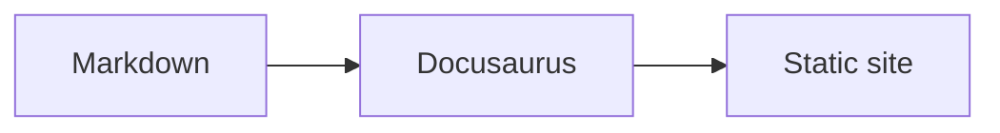

# 文档图表

文档站在构建时将图表源码转换为 SVG 或 PNG。短图可以直接写在 Markdown 里，较长的图可以保存在同目录的文件中。

## 本地预览

在 `doc/` 下安装依赖和 Chromium，再运行 `pnpm start`。发布前运行 `pnpm build` 验证中英文页面。
Windows PowerShell 下可以使用 `pnpm.cmd`。

```bash
pnpm install
pnpm diagrams:install-browser
pnpm start
```

D2 使用 D2 CLI 0.9.0。PlantUML 使用 Java、PlantUML 1.2026.8 JAR 和 Graphviz（组件图等布局需要 `dot`）。
将工具加入 PATH，并将 `PLANTUML_JAR` 设置为 JAR 文件路径。也可用 `D2_BINARY`、`JAVA_BINARY` 指定可执行文件，
或用 `PLAYWRIGHT_CHROMIUM_EXECUTABLE_PATH` 指定已有的 Chromium。跨平台构建时请安装中文字体，例如 Noto Sans CJK SC。

## 写法

| 图表 | 围栏语言 | 文件后缀 | 输出 |
| --- | --- | --- | --- |
| D2 | `d2` | `.d2` | 内联 SVG |
| PlantUML | `plantuml` | `.puml`、`.plantuml` | 内联 SVG |
| Mermaid | `mermaid` | `.mermaid`、`.mmd` | 浅色和深色 SVG |
| ECharts | `echarts` | `.echarts.json` | 二维图为 SVG，WebGL 图为 PNG |
| Chart.js | `chartjs`、`chart` | `.chart.json` | PNG |

图片语法使用相对于当前文档的文件路径。D2 的相对导入和本地图片、PlantUML 的本地 `!include` 以图表源文件目录为基准；
内联图以文档目录为基准。PlantUML 每张图使用一对 `@startuml` 和 `@enduml`，本地 include 限定在对应语言的文档树内。
修改图表或其本地依赖后，开发服务器会重新编译引用它的页面。语法错误和缺失文件会在编译时报告。

MDX `<Diagram>` 可用 `src` 引用相对路径，或用 `source` 提供字符串。给图片、围栏或标签添加 `alt` 来描述图表。
图表 JSON 使用固定尺寸导出。ECharts 会识别 WebGL 系列，也可用围栏属性 `{extensions="gl"}` 或 MDX 属性 `extensions="gl"` 显式启用。
WebGL 输出记录一个固定视角，动画和鼠标交互需要在浏览器运行图表库。

## 示例

### D2 文件

```markdown

```


### Mermaid 代码块



### PlantUML 的 MDX 写法

```mdx
<Diagram
  type="plantuml"
  source={'@startuml\nAuthor -> Build: Render\nBuild --> Author: SVG\n@enduml'}
  alt="Build sequence"
/>
```

<Diagram
  type="plantuml"
  source={'@startuml\nAuthor -> Build: Render\nBuild --> Author: SVG\n@enduml'}
  alt="文档构建时序"
/>

### ECharts 与 Chart.js

```echarts {alt="Requests handled per hour"}
{
  "xAxis": {"type": "category", "data": ["09:00", "10:00", "11:00"]},
  "yAxis": {"type": "value"},
  "series": [{"type": "line", "data": [18, 26, 23]}]
}
```

```chartjs {alt="Requests by service"}
{
  "type": "bar",
  "data": {
    "labels": ["Lobby", "Match", "Chat"],
    "datasets": [{"label": "Requests", "data": [18, 26, 23]}]
  }
}
```

### ECharts WebGL

```echarts {extensions="gl" alt="Surface plot of a peak"}
{
  "xAxis3D": {},
  "yAxis3D": {},
  "zAxis3D": {},
  "grid3D": {},
  "series": [{
    "type": "surface",
    "data": [[-1,-1,0], [-1,0,1], [-1,1,0], [0,-1,1], [0,0,2], [0,1,1], [1,-1,0], [1,0,1], [1,1,0]]
  }]
}
```
