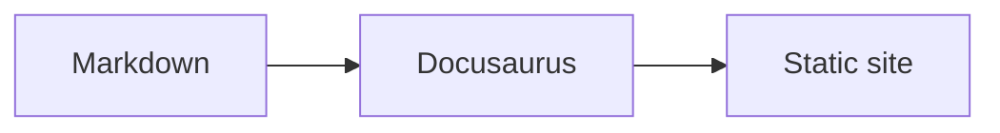

# Documentation Diagrams

The site converts diagram sources to SVG or PNG at build time. Put short diagrams in Markdown and keep longer sources in files alongside the page.

## Local Preview

From `doc/`, install the dependencies and Chromium, then run `pnpm start`. Run `pnpm build` before publishing to check both locales.
Use `pnpm.cmd` in Windows PowerShell.

```bash
pnpm install
pnpm diagrams:install-browser
pnpm start
```

D2 uses D2 CLI 0.9.0. PlantUML uses Java, the PlantUML 1.2026.8 JAR, and Graphviz (`dot` is required for layouts such as component diagrams).
Put the tools on PATH and set `PLANTUML_JAR` to the JAR path. Use `D2_BINARY` and `JAVA_BINARY` to override the executables, or
`PLAYWRIGHT_CHROMIUM_EXECUTABLE_PATH` to use an existing Chromium installation. Install a Chinese font such as Noto Sans CJK SC on each build platform.

## Syntax

| Diagram | Fence language | File extension | Output |
| --- | --- | --- | --- |
| D2 | `d2` | `.d2` | Inline SVG |
| PlantUML | `plantuml` | `.puml`、`.plantuml` | Inline SVG |
| Mermaid | `mermaid` | `.mermaid`、`.mmd` | Light and dark SVG |
| ECharts | `echarts` | `.echarts.json` | SVG for 2D charts, PNG for WebGL charts |
| Chart.js | `chartjs`、`chart` | `.chart.json` | PNG |

Markdown image paths are relative to the current document. D2 resolves relative imports and local images from the diagram’s directory,
as does PlantUML for local `!include` directives. Inline diagrams use the document directory. Each PlantUML diagram takes one
`@startuml` and `@enduml` pair, with local includes limited to the current locale’s documentation tree.
The development server recompiles a page when its diagram or local dependencies change. Compilation reports syntax errors and missing files.

Use MDX `<Diagram>` with a relative `src` or a string `source`. Add `alt` to describe the diagram in image references, fences, or MDX.
JSON charts export at fixed dimensions. ECharts detects WebGL series, and you can enable WebGL explicitly with `{extensions="gl"}` in a fence
or `extensions="gl"` in MDX. The WebGL image captures a fixed view. Animation and pointer interaction require the chart library in the browser.

## Examples

### D2 File

```markdown

```


### Mermaid Fence



### PlantUML in MDX

```mdx
<Diagram
  type="plantuml"
  source={'@startuml\nAuthor -> Build: Render\nBuild --> Author: SVG\n@enduml'}
  alt="Build sequence"
/>
```

<Diagram
  type="plantuml"
  source={'@startuml\nAuthor -> Build: Render\nBuild --> Author: SVG\n@enduml'}
  alt="Build sequence"
/>

### ECharts and Chart.js

```echarts {alt="Requests handled per hour"}
{
  "xAxis": {"type": "category", "data": ["09:00", "10:00", "11:00"]},
  "yAxis": {"type": "value"},
  "series": [{"type": "line", "data": [18, 26, 23]}]
}
```

```chartjs {alt="Requests by service"}
{
  "type": "bar",
  "data": {
    "labels": ["Lobby", "Match", "Chat"],
    "datasets": [{"label": "Requests", "data": [18, 26, 23]}]
  }
}
```

### ECharts WebGL

```echarts {extensions="gl" alt="Surface plot of a peak"}
{
  "xAxis3D": {},
  "yAxis3D": {},
  "zAxis3D": {},
  "grid3D": {},
  "series": [{
    "type": "surface",
    "data": [[-1,-1,0], [-1,0,1], [-1,1,0], [0,-1,1], [0,0,2], [0,1,1], [1,-1,0], [1,0,1], [1,1,0]]
  }]
}
```
